# Sơ Đồ Thực Thể Liên Kết (ERD) — Hệ Thống CS445

Tài liệu được sinh tương ứng với cấu trúc `backend/prisma/schema.prisma` (23 bảng PostgreSQL).

```mermaid
erDiagram
    ROLE ||--o{ USER : "primary_role"
    ROLE ||--o{ USER_ROLE : "assigned"
    USER ||--o{ USER_ROLE : "has"
    ROLE ||--o{ ROLE_PERMISSION : "grants"
    PERMISSION ||--o{ ROLE_PERMISSION : "included_in"
    USER ||--o{ REFRESH_TOKEN : "owns"
    USER ||--o{ SYSTEM_AUDIT_LOG : "records"

    BRANCH ||--o{ USER : "employs"
    BRANCH ||--o{ ZONE : "contains"
    ZONE ||--o{ BIN : "contains"

    CATEGORY ||--o{ PRODUCT : "classifies"
    BRANCH ||--o{ STOCK : "stores"
    PRODUCT ||--o{ STOCK : "stocked_in"
    BIN ||--o{ STOCK : "locates"

    BRANCH ||--o{ INVENTORY_TICKET : "manages"
    USER ||--o{ INVENTORY_TICKET : "creates_approves"
    INVENTORY_TICKET ||--o{ INVENTORY_TICKET_DETAIL : "contains"
    PRODUCT ||--o{ INVENTORY_TICKET_DETAIL : "item"
    BIN ||--o{ INVENTORY_TICKET_DETAIL : "target_bin"

    BRANCH ||--o{ TRANSFER_TICKET : "source_dest"
    USER ||--o{ TRANSFER_TICKET : "creates_approves"
    TRANSFER_TICKET ||--o{ TRANSFER_TICKET_DETAIL : "contains"
    TRANSFER_TICKET ||--o{ TRANSFER_TRACKING_LOG : "gps_logs"
    PRODUCT ||--o{ TRANSFER_TICKET_DETAIL : "item"

    BRANCH ||--o{ STOCK_CHECK : "audits"
    USER ||--o{ STOCK_CHECK : "creates_approves"
    STOCK_CHECK ||--o{ STOCK_CHECK_DETAIL : "contains"
    PRODUCT ||--o{ STOCK_CHECK_DETAIL : "item"
    BIN ||--o{ STOCK_CHECK_DETAIL : "checked_bin"

    BRANCH ||--o{ CUSTOMER_ORDER : "fulfills"
    CUSTOMER_ORDER ||--o{ CUSTOMER_ORDER_DETAIL : "contains"
    PRODUCT ||--o{ CUSTOMER_ORDER_DETAIL : "ordered_item"

    BRANCH ||--o{ AI_ALERT : "alerts"
    PRODUCT ||--o{ AI_ALERT : "alerts"
    TRANSFER_TICKET ||--o{ AI_ALERT : "alerts"
    CUSTOMER_ORDER ||--o{ AI_ALERT : "alerts"
    USER ||--o{ AI_ALERT : "resolves"
```

## Tóm tắt 23 Bảng theo Nhóm Nghiệp Vụ
1. **IAM & Bảo mật (5 bảng):** `role`, `permission`, `role_permission`, `user_role`, `refresh_token`
2. **Hạ tầng kho & Nhân sự (4 bảng):** `branch`, `user`, `zone`, `bin`
3. **Danh mục & Tồn kho (3 bảng):** `category`, `product`, `stock`
4. **Nghiệp vụ Kho & Điều chuyển (7 bảng):** `inventory_ticket`, `inventory_ticket_detail`, `transfer_ticket`, `transfer_ticket_detail`, `transfer_tracking_log`, `stock_check`, `stock_check_detail`
5. **Đơn hàng, Kiểm toán & AI (4 bảng):** `customer_order`, `customer_order_detail`, `system_audit_log`, `ai_alert`
